# [Near-Field Source DOA Estimation]Improved Near-Field MUSIC Algorithm Based on Higher Order Cumulants [with MATLAB Code]

\t  
MATLAB Simulation Code  
More radar and communication MATLAB codes
%FOURTH ORDER MUSIC ALOGRITHM\n%DOA ESTIMATION BY FOURTH ORDER MUSIC\nclear all;\n% close all;\nclc;\n​\nsource_number=2;% Packet count\nsensor_number=8;%Number of elements\nN_x=512; % Signal Length\nsnapshot_number=N_x;% Quick Snap Count\nw=[pi/4 pi/6].';% Signal Frequency\nl=((2*pi*3e8)/w(1)+(2*pi*3e8)/w(2))/2;% Signal wavelength\nd=0.5*l;%Element spacing\nsnr=0;% Signal-to-noise ratio\n​\nsource_doa=[-45 50];%The incident angles of two signals\nA=[exp(-j*(0:sensor_number-1)*d*2*pi*sin(source_doa(1)*pi/180)/l);exp(-j*(0:sensor_number-1)*d*2*pi*sin(source_doa(2)*pi/180)/l)].';% Array Flow Pattern\n​\ns=sqrt(10.^(snr/10))*exp(j*w*[0:N_x-1]);% Simulation signal\n%x=awgn(s,snr);\nx=A*s+(1/sqrt(2))*(randn(sensor_number,N_x)+j*randn(sensor_number,N_x));% Array receiving signal after adding Gaussian white noise\n% Calculate the cumulant of order 4\n  

## Images

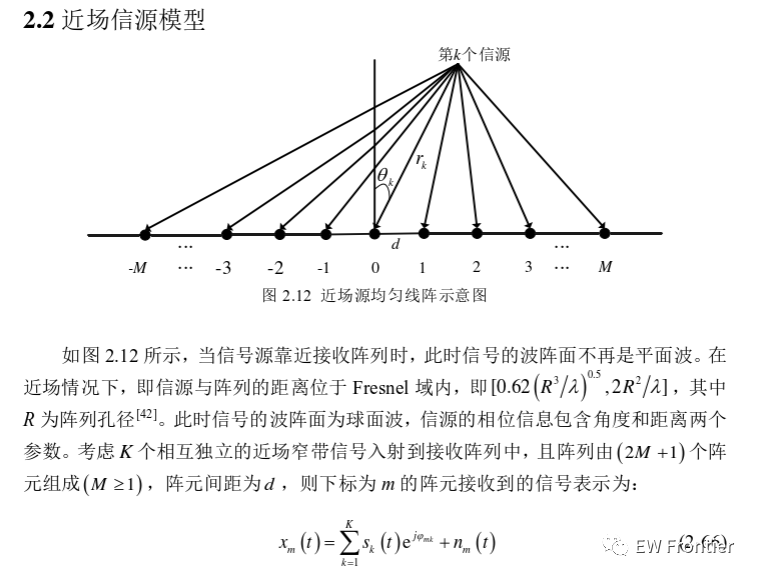
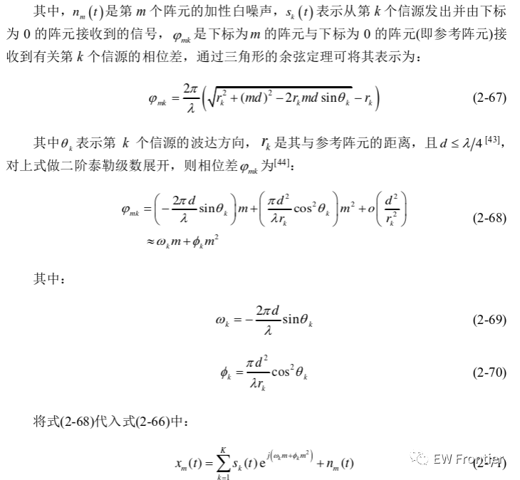
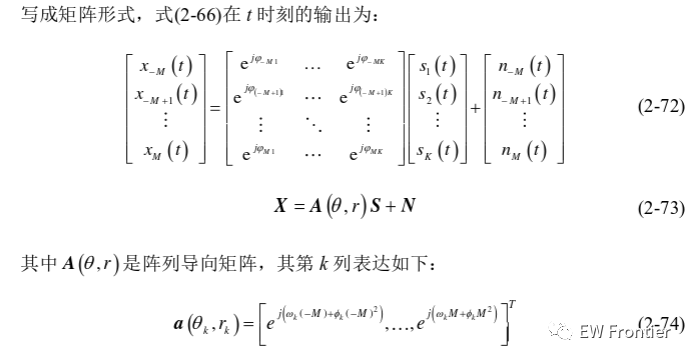
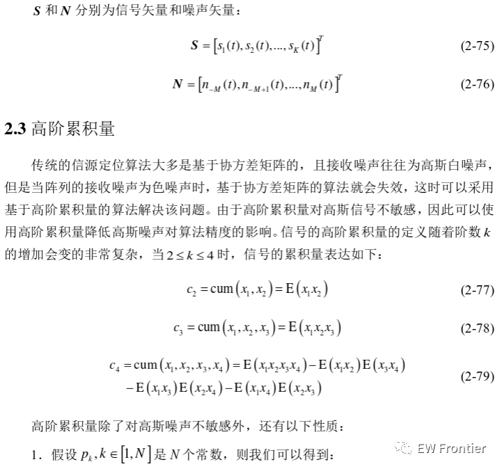
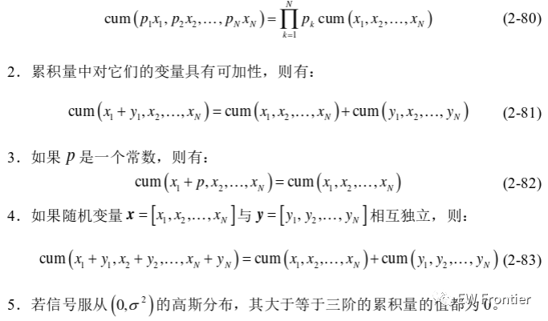
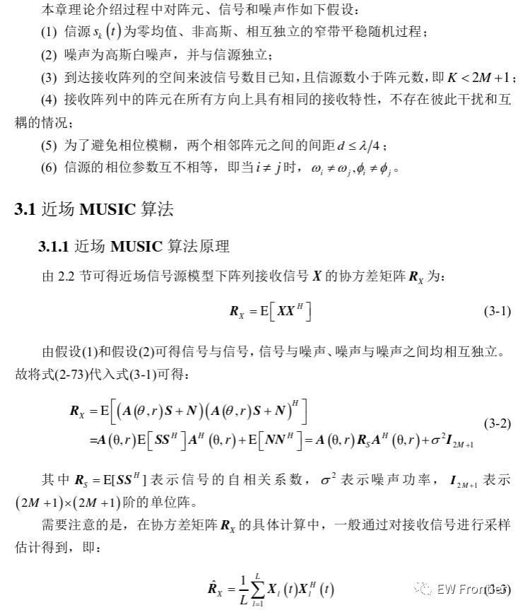
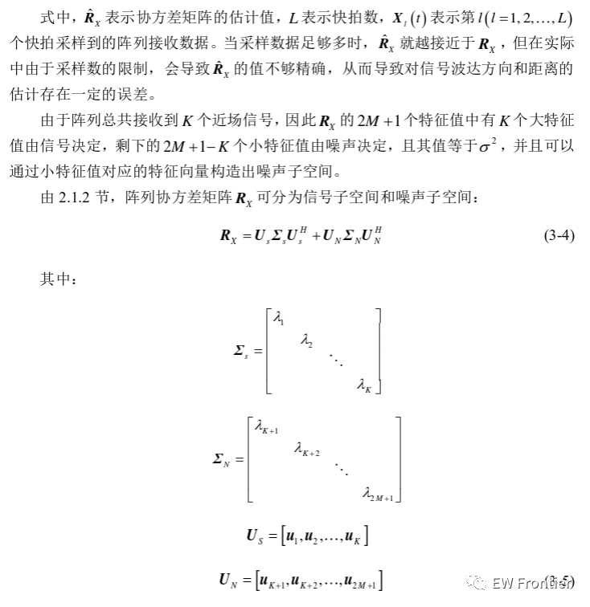
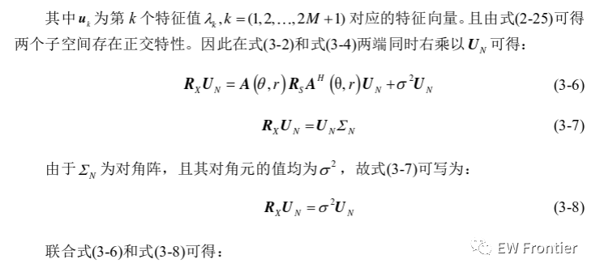
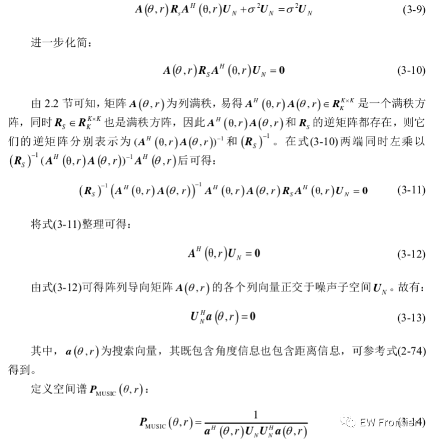
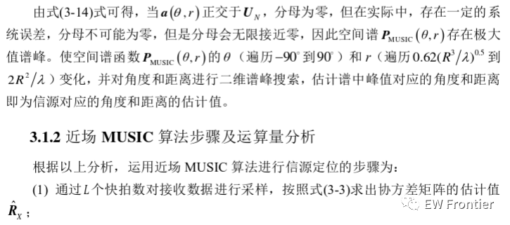
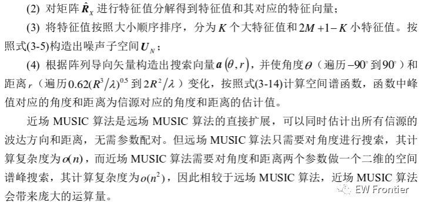
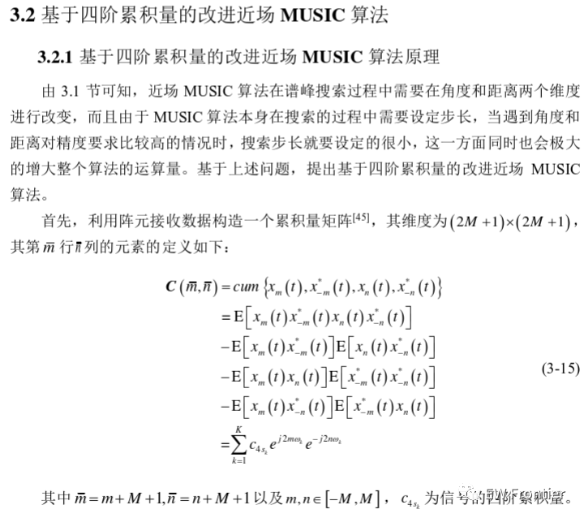
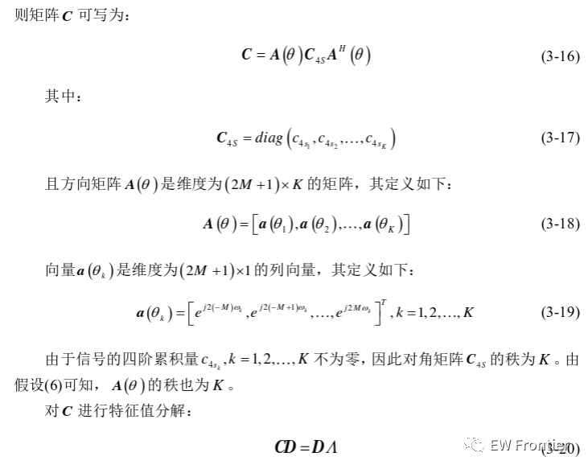
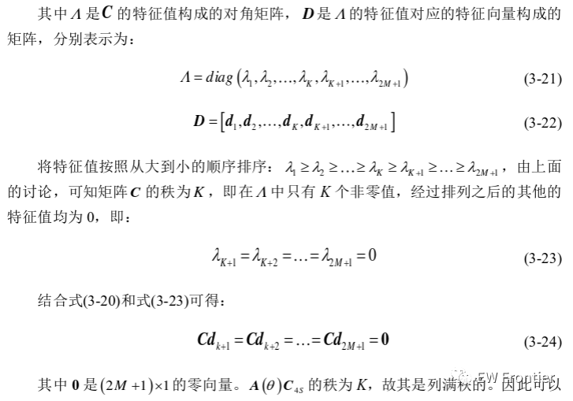
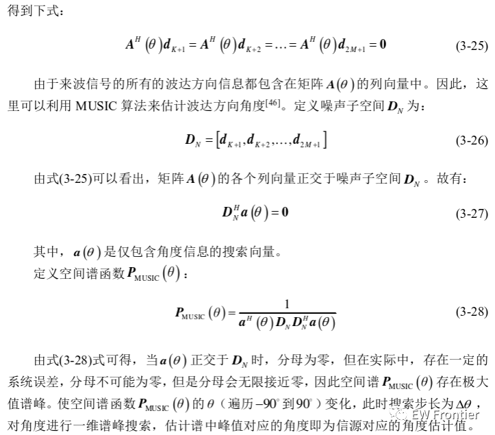
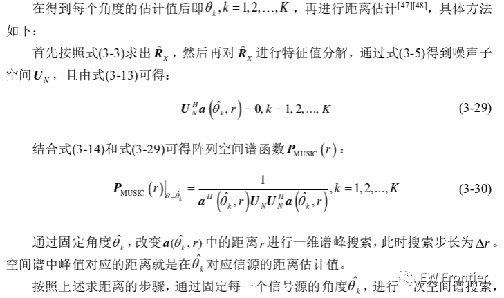
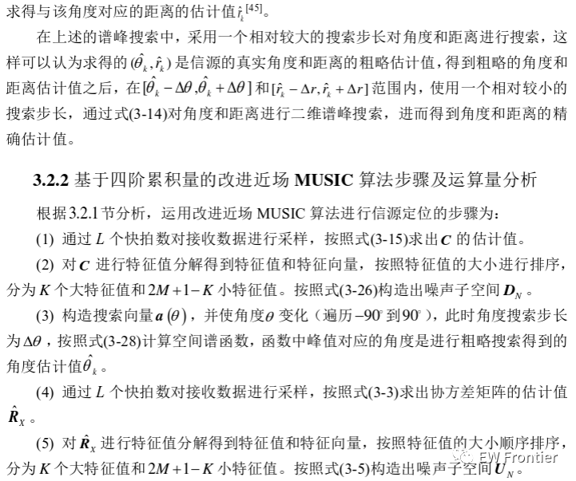
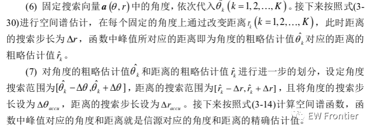
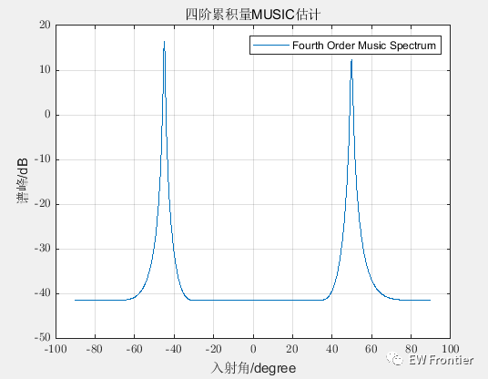
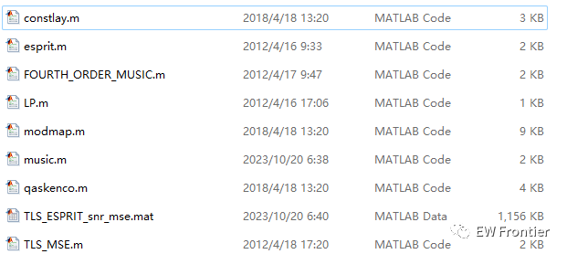

<!-- PAYMENT_BLOCK -->

## Get this dataset

- Payment link (Stripe): [Buy now](https://buy.stripe.com/3cs8yP7sY87d0vu9AB)
- Payment QR code: 

<!-- /PAYMENT_BLOCK -->
